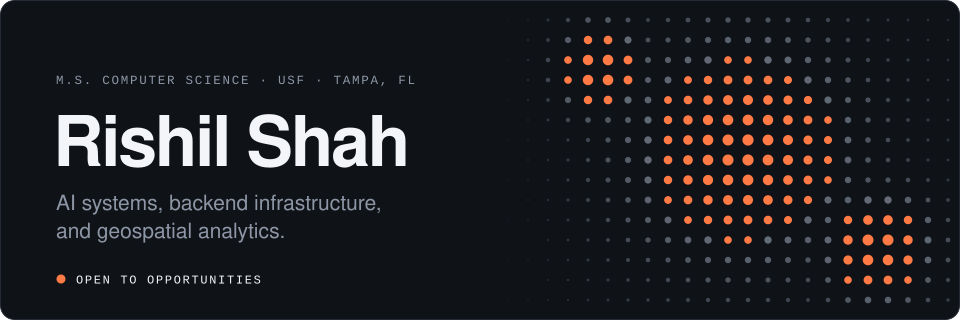
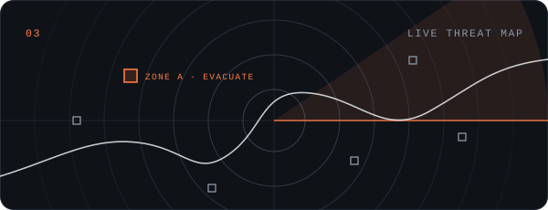
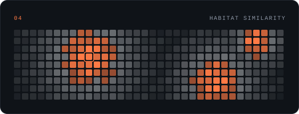

<a href="https://rishil121.vercel.app">
  <picture>
    <source media="(prefers-color-scheme: dark)" srcset="assets/header-dark.svg">
    <source media="(prefers-color-scheme: light)" srcset="assets/header-light.svg">
    
  </picture>
</a>

 

I build AI systems that turn messy data into decisions: LLM agents and RAG pipelines, the backend and data infrastructure underneath them, and geospatial models for public health. Right now I'm an AI Architect Intern at NMEDA and a SCADA developer at the University of South Florida, where I finish my M.S. in Computer Science in December 2026.

**[Portfolio](https://rishil121.vercel.app)** &nbsp;·&nbsp; **[Résumé](https://rishil121.vercel.app/Rishil_Shah_Resume.pdf)** &nbsp;·&nbsp; **[LinkedIn](https://www.linkedin.com/in/rishilshah1211/)** &nbsp;·&nbsp; **[Email](mailto:rishil1211@icloud.com)**

 

## Selected work

<table>
  <tr>
    <td width="50%" valign="top">
      <a href="https://github.com/rshah2001/runway">
        <picture>
          <source media="(prefers-color-scheme: dark)" srcset="assets/runway-dark.svg">
          <source media="(prefers-color-scheme: light)" srcset="assets/runway-light.svg">
          
        </picture>
      </a>
      <h3>Runway</h3>
      
A banking app that forecasts your balance day by day and, before you run short, arranges consent-based help from family and friends, sized so it is safe for each helper and without anyone seeing anyone else's balance.

      
<b>Winner, Best Use of Nessie API (Capital One), SwampHacks XII.</b> 85 pull requests merged in about 48 hours by a team of three.

      
<code>Python</code> <code>FastAPI</code> <code>TimescaleDB</code> <code>Gemini</code> <code>React Native</code> <code>Docker</code>

      
<a href="https://sixsevenbucksleft.vip">Live</a> &nbsp;·&nbsp; <a href="https://github.com/rshah2001/runway">Code</a>

    </td>
    <td width="50%" valign="top">
      <a href="https://github.com/rshah2001/Marketplace-AI-Agent">
        <picture>
          <source media="(prefers-color-scheme: dark)" srcset="assets/marketplace-dark.svg">
          <source media="(prefers-color-scheme: light)" srcset="assets/marketplace-light.svg">
          
        </picture>
      </a>
      <h3>Marketplace AI Agent</h3>
      
A retrieval-augmented agent for people who resell. It reads a marketplace listing, pulls comparable resale context, and returns a recommendation on whether the flip is worth it and why.

      
<code>Python</code> <code>FastAPI</code> <code>ChromaDB</code> <code>OpenAI</code> <code>Streamlit</code>

      
<a href="https://github.com/rshah2001/Marketplace-AI-Agent">Code</a>

    </td>
  </tr>
  <tr>
    <td width="50%" valign="top">
      <a href="https://github.com/rshah2001/BayShield-main">
        <picture>
          <source media="(prefers-color-scheme: dark)" srcset="assets/bayshield-dark.svg">
          <source media="(prefers-color-scheme: light)" srcset="assets/bayshield-light.svg">
          
        </picture>
      </a>
      <h3>BayShield</h3>
      
A real-time, multi-agent disaster response platform for Tampa Bay. It assesses threats from live NOAA and NWS feeds, maps vulnerable zones, and coordinates emergency actions.

      
<b>3rd place, HackUSF.</b> Presented to the Tampa Bay Regional Planning Council.

      
<code>TypeScript</code> <code>React</code> <code>Python</code> <code>Snowflake</code> <code>AWS</code>

      
<a href="https://github.com/rshah2001/BayShield-main">Code</a>

    </td>
    <td width="50%" valign="top">
      <a href="https://github.com/rshah2001/Interpolator">
        <picture>
          <source media="(prefers-color-scheme: dark)" srcset="assets/habitat-dark.svg">
          <source media="(prefers-color-scheme: light)" srcset="assets/habitat-light.svg">
          
        </picture>
      </a>
      <h3>Habitat Similarity Mapping</h3>
      
Geospatial machine learning on Sentinel-2 satellite imagery. Given a reference site, it scores every other location for environmental similarity and renders the result as an interactive map.

      
<code>Python</code> <code>Google Earth Engine</code> <code>Random Forest</code> <code>Geemap</code>

      
<a href="https://github.com/rshah2001/Interpolator">Code</a>

    </td>
  </tr>
</table>

 

## Research

I work on geospatial AI for public health at USF: training models on satellite and health data to find where disease risk concentrates, so screening and vector control can be aimed there. That work has produced eight peer-reviewed journal articles and two Springer book chapters.

- **[Uncertainty Quantification in ZCTA-Level Breast Cancer Screening: A Bayesian Geospatial Analysis in Hillsborough County, Florida](https://doi.org/10.3390/ijerph23070911)** *International Journal of Environmental Research and Public Health*, 2026
- **[Scaling Point-Based Habitat Observations of *Anopheles stephensi* Using XGBoost to Support Larval Source Management in Kisumu, Kenya](https://doi.org/10.11648/j.aje.20261003.11)** *American Journal of Entomology*, 2026
- **Machine Learning for West Nile Virus Mapping in Italy** Chapter in *GeoAI for Public Health*, Springer, 2026

All ten publications

 

**Journal articles**

1. Reddy, B., Satardekar, A., Choudhari, N., Jacob, B.G., **Shah, R.**, Parajuli, A. [Uncertainty Quantification in Zip Code Tabulation Area-Level Breast Cancer Screening: A Bayesian Geospatial Analysis in Hillsborough County, Florida](https://doi.org/10.3390/ijerph23070911). *International Journal of Environmental Research and Public Health*, 23, 911 (2026).
2. Asher, O., **Shah, R.**, Satardekar, A., Parajuli, A., Choudhari, N., Jedrzejczyk, J., Mwangangi, J., Mbogo, C., Jacob, B. [Scaling Point-Based Habitat Observations of *Anopheles stephensi* Using XGBoost to Support Seek-and-Destroy Larval Source Management in Kisumu, Kenya](https://doi.org/10.11648/j.aje.20261003.11). *American Journal of Entomology*, 10(3), 45–61 (2026).
3. Cervantes-Trejo, S., Satardekar, A., **Shah, R.**, Choudhari, N., Parajuli, A., Jacob, B. [A Spatial Modeling Framework for Cervical Cancer Burden Using Eigenvector Spatial Filtering: A ZCTA-Level Study in Hillsborough County, Florida](https://doi.org/10.5897/JPHE2026.1578). *Journal of Public Health and Epidemiology*, 19(3), 128–137 (2026).
4. Warms, D., Satardekar, A., Parajuli, A., **Shah, R.**, Bhandaru, S., Choudhari, N., Jacob, B.G. [Moran's Eigen-Spatial Analytic Methods for Mapping Hot and Cold Spots of Uterine Cancer in Hillsborough County, Florida](https://doi.org/10.5923/j.ajms.20261501.03). *American Journal of Mathematics and Statistics*, 15(1), 10–20 (2026).
5. Rodriguez, N.I., Satardekar, A., Choudhari, N., Bhandaru, S., Parajuli, A., **Shah, R.**, Jacob, B.G. [Exploratory Spatial Risk Modeling of Chlamydia Vulnerability at the ZCTA Level Using Spatial Filtering and Sentinel-2 Data](https://doi.org/10.5923/j.ajms.20261502.01). *American Journal of Mathematics and Statistics*, 15(2), 21–30 (2026).
6. Singh, A., Satardekar, A., Parajuli, A., Bhandaru, S., Choudhari, N., **Shah, R.**, Komrojki, S., Jacob, B.G. [Spatial Autocorrelation of Pancreatic Cancer Incidence Across ZIP Codes in Hillsborough County, Florida](https://doi.org/10.14738/bjhr.1302.20170). *British Journal of Healthcare and Medical Research*, 13(2), 232–242 (2026).
7. Eaton, K., Satardekar, A., Choudhari, N., **Shah, R.**, Jacob, B.G. [Decomposition of Moran's Coefficient to Detect Non-Multicollinear, Non-Zero, Eigen-Autocorrelated, Non-Gaussian Coefficients in Colorectal Cancer Estimator Determinants Epidemiologically Sampled in Hillsborough County, Florida](https://doi.org/10.33552/ABBA.2026.07.000657). *Annals of Biostatistics & Biometric Applications*, 7(2) (2026).
8. Satardekar, A., Choudhari, N., **Shah, R.**, Sanders, Z., Stanley, N.B., Jacob, B.G. [Volatility Forecasting Scalable Oncological Signatures by Temporally Denoising Quadratic Heteroscedasticity in a Platykurtic Student T-Distributed Thick-Tailed Non-Asymptotical Regression Model Output for Targeting County-Level Hot Spots of Leukemia Patient Households in Florida](https://doi.org/10.33552/ABBA.2025.06.000648). *Annals of Biostatistics & Biometric Applications* (2025).

**Book chapters**

9. Spada, S., **Shah, R.**, Choudhari, N., Jacob, B.G. Machine Learning for West Nile Virus Mapping in Italy. In *GeoAI for Public Health*, Springer (2026).
10. Mansoor, A., **Shah, R.**, Moscich, S., Choudhari, N., Jacob, B.G. Multispectral AI Mapping of Dengue Control in Brazil. In *GeoAI for Public Health*, Springer (2026).

 

## Experience

<table>
  <tr>
    <td valign="top"><b>AI Architect Intern</b> NMEDA</td>
    <td valign="top" nowrap>May 2026 – now</td>
    <td valign="top">LLM agents and workflows inside production pipelines, plus ETL and data-reconciliation pipelines into PostgreSQL with authentication, role-based access, and audit logging.</td>
  </tr>
  <tr>
    <td valign="top"><b>SCADA Developer</b> University of South Florida</td>
    <td valign="top" nowrap>Jan 2025 – now</td>
    <td valign="top">Real-time ingestion, monitoring, and dashboards across more than 200 building-automation systems, and the migration from Alerton to Niagara.</td>
  </tr>
  <tr>
    <td valign="top"><b>Graduate Research Assistant, Geospatial AI</b> University of South Florida</td>
    <td valign="top" nowrap>Jul 2025 – now</td>
    <td valign="top">Machine-learning and Bayesian spatial models on satellite and public-health data, producing the risk maps behind the publications above.</td>
  </tr>
  <tr>
    <td valign="top"><b>Software Development Intern</b> Galileo Group</td>
    <td valign="top" nowrap>Summer 2023</td>
    <td valign="top">Faster, more reliable image-processing and facial-recognition pipelines with fewer false positives.</td>
  </tr>
</table>

 

## Toolkit

<table>
  <tr>
    <td valign="top"><b>AI</b></td>
    <td valign="top">LLM agents and multi-agent orchestration, RAG, OpenAI, Gemini, LangChain, ChromaDB, scikit-learn, XGBoost</td>
  </tr>
  <tr>
    <td valign="top"><b>Backend</b></td>
    <td valign="top">Python, FastAPI, Django, Flask, Node.js, REST APIs, C, C#</td>
  </tr>
  <tr>
    <td valign="top"><b>Data and cloud</b></td>
    <td valign="top">PostgreSQL, TimescaleDB, Snowflake, ETL/ELT, AWS, Docker, GitHub Actions</td>
  </tr>
  <tr>
    <td valign="top"><b>Apps</b></td>
    <td valign="top">React, React Native, Flutter, TypeScript</td>
  </tr>
  <tr>
    <td valign="top"><b>Geospatial</b></td>
    <td valign="top">Google Earth Engine, Sentinel-2, spatial statistics</td>
  </tr>
</table>
